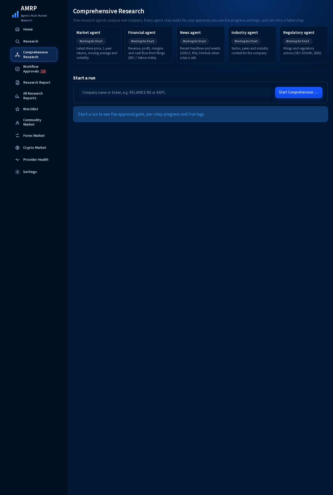
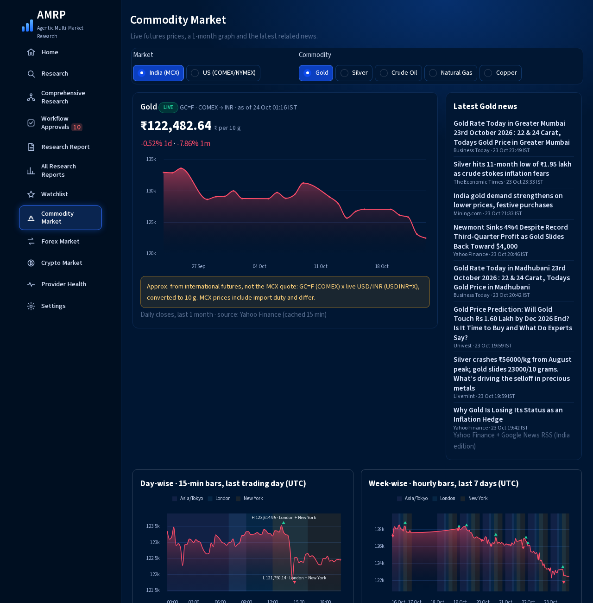
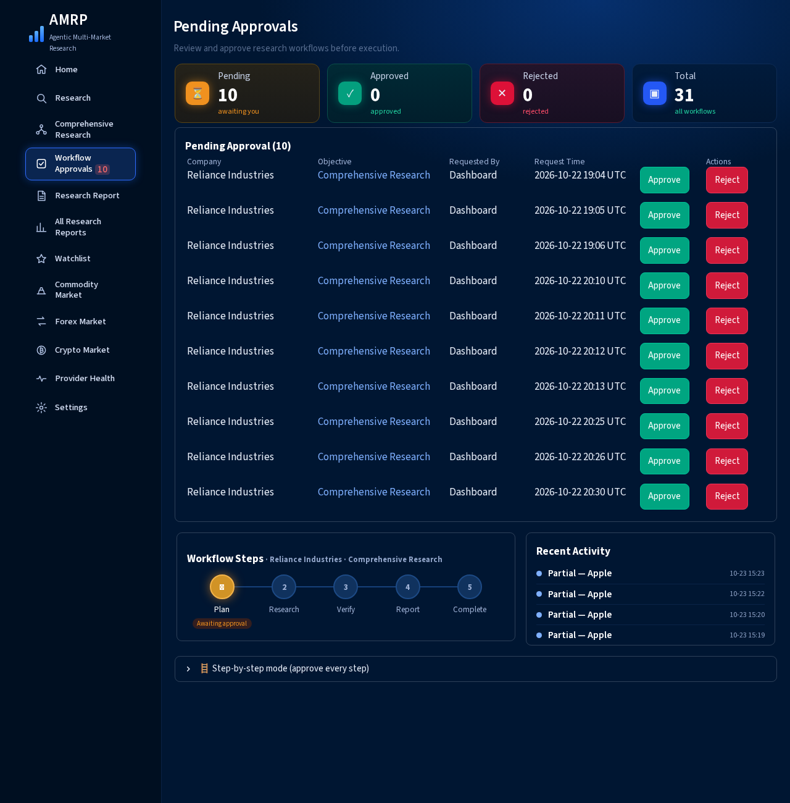

# AMRP – Agentic Multi-Market Research Platform

[](https://github.com/LeelaissakAttota/agentic-equity-research-platform/actions/workflows/ci.yml)


[](LICENSE)

**AMRP** is an evidence-first, agentic research assistant for **four markets**: **equities** (India NSE/BSE and US NASDAQ/NYSE), **commodities**, **forex** and **crypto**. Give it a company and a question: it resolves the company, plans bounded research, runs five specialist agents, verifies every claim against time-aware evidence and produces a traceable report (JSON / Markdown / Word). LLM use is **free-model-first** via OpenRouter; paid models only by explicit opt-in, and every default is zero-cost.

## Demo video

<!-- DEMO VIDEO LINK: replace both occurrences of https://VIDEO_LINK below with the shared video link
     (for a Drive file use https://drive.google.com/file/d/<FILE_ID>/preview so it plays directly). -->
[](https://VIDEO_LINK)

▶ [Watch the AMRP demo video](https://VIDEO_LINK)
<!-- END DEMO VIDEO LINK -->

## Screenshots

**Comprehensive Research – five agents, each step approved, run completed**



| **Commodity market (live prices, session charts, news)** | **Workflow Approvals (human in the loop)** |
|---|---|
|  |  |

## Key features

| Feature | What it does |
|---|---|
| **Research** | One box: type a company and a question. Company and research objective are detected automatically; suggested US and India companies are one click away. Results: analyst summary, key figures, news, regulatory items and a Markdown/Word download, each claim tagged with its evidence (`[M1]` market, `[F1]` financial, `[N1]` news, `[R1]` regulatory). |
| **Comprehensive Research** | Five specialist agents (Market, Financial, News, Industry, Regulatory) with live per-agent status (Waiting for Start → Queued → Running → Done), progress and a live log. |
| **Step-by-step mode** | Human-in-the-loop control: every stage (Plan → Research → Verify → Report) pauses for **Approve / Reject**; failed or rejected steps can be retried. |
| **Workflow Approvals** | Pending / approved / rejected counts, the approval queue, workflow steps and recent activity. |
| **All Research Reports** | Search, filter and export (CSV) every research report; open any report again. |
| **Finnhub analyst ratings** | With an optional free Finnhub key: US company news, analyst consensus (Strong Buy … Strong Sell) and the next earnings date, labelled as third-party opinion, not fact. |
| **Commodity, Forex, Crypto markets** | Live prices (Yahoo Finance, no key), INR conversion, related news, day-wise and week-wise session charts marking whether the high/low formed in the Asia, London or New York session (IST), and **Analyze with AI** for a cited free-model summary. |
| **Provider Health** | `/health/providers` and a dashboard page showing each live source (Yahoo, NSE, BSE, SEC, Finnhub, company universe, …) as unused / ok / degraded / failing, with last success and failure. |
| **Settings** | Guided provider setup (OpenRouter, OpenAI, Anthropic, Gemini, Groq, custom OpenAI-compatible) with key auto-detection, Test connection and write-only Save; optional Alpha Vantage / Finnhub keys and live-data toggles. |
| **Free-model-first LLM routing** | Discovers and ranks OpenRouter `:free` models and falls back automatically; paid models only when you opt in ([MODEL_POLICY.md](MODEL_POLICY.md)). |

## How it works

```
Company + question → Resolve identity → Plan (bounded tasks) → 5 specialist agents
   → Verify claims against evidence → Synthesize → Report (JSON / Markdown / Word)
```

Every agent step can require approval; every claim keeps its evidence reference, source tier and timestamp. See [ARCHITECTURE.md](ARCHITECTURE.md), [EVIDENCE_MODEL.md](EVIDENCE_MODEL.md) and the [architecture diagram](docs/architecture/agentic-financial-intelligence-platform.png).

## Quick start

```bash
python -m pip install -r requirements-lock.txt && python -m pip install -e . --no-deps
cp .env.example .env            # add OPENROUTER_API_KEY (free models); everything else is optional
python -m uvicorn financial_intelligence.main:app --reload   # REST API: http://127.0.0.1:8000/docs
```

Dashboard (Windows, from the repo root):

```powershell
.\scripts\start-dashboard.ps1        # opens http://127.0.0.1:8501
```

This starts the REST API (`:8000`), the control API (`:8712`, random per-session token) and the Streamlit dashboard (`:8501`), all bound to `127.0.0.1`. Every section carries a badge: **LIVE**, **LIVE (cached)**, **SAMPLE DATA** or **NOT AVAILABLE**. Optional keys: `FINNHUB_API_KEY`, `ALPHA_VANTAGE_API_KEY`, `SEC_USER_AGENT` (see `.env.example`). A walkthrough is in [docs/DEMO.md](docs/DEMO.md).

## Live vs sample data

Everything runs offline on bundled, clearly labelled sample data by default; live adapters are opt-in.

| Capability | Default (offline) | Live option |
|---|---|---|
| Company identity | Bundled catalog | Full BSE equity list + SEC ticker list (renames/demergers mapped) |
| Market quotes/history | Sample dataset | Yahoo Finance (no key), Alpha Vantage (optional), NSE/BSE live quotes |
| Financials | Sample dataset | SEC EDGAR XBRL (US), Yahoo fundamentals (India) |
| News & events | Sample dataset | GDELT, Google News RSS, NSE/BSE announcements, Finnhub (optional key) |
| Regulatory events | Sample dataset | SEC litigation/admin RSS, SEBI RSS |
| Planner / analyst summary | Deterministic | Free OpenRouter model, with cited evidence |

Details: [DATA_SOURCES.md](DATA_SOURCES.md).

## Tests and quality

**1,564 tests** (unit, contract, integration and evaluation) run in CI on Python 3.12 and 3.13.

```bash
python -m pytest
python -m ruff check . && python -m ruff format --check .
python -m mypy src
```

See [TESTING_STRATEGY.md](TESTING_STRATEGY.md).

## Tech stack

Python 3.12+, FastAPI, Streamlit, Pydantic, OpenRouter (free models), Yahoo Finance, SEC EDGAR, NSE/BSE, GDELT, Finnhub, Docker.

## Security

API keys are write-only in Settings and never logged or shown; services bind to `127.0.0.1`; the control API uses a random per-session token; network access is host-allowlisted. See [SECURITY_GUIDELINES.md](SECURITY_GUIDELINES.md) and the [threat model](docs/security/THREAT_MODEL.md).

## More docs

[API examples](docs/API-EXAMPLES.md) · [Control API](docs/CONTROL_API.md) · [Runbook](docs/operations/RUNBOOK.md) · [Changelog](CHANGELOG.md) · [Contributing](CONTRIBUTING.md)

> The Python package is `financial_intelligence` (distribution `agentic-financial-intelligence`), kept stable for compatibility.

## License

[MIT](LICENSE) © 2026 Attota Leelaissak
