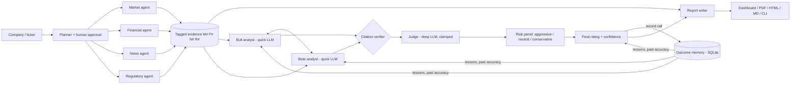

# AMRP – Agentic Multi-Market Research Platform

Production-oriented, evidence-first research infrastructure for equities (India NSE/BSE and US NASDAQ/NYSE), commodities, forex and crypto.

> **Current status:** `v1.0.0` released, now extended with a Streamlit research dashboard, five specialist agents with human-in-the-loop approvals, a Bull/Bear debate + risk panel with a citation-verified rating, outcome memory, point-in-time backtests, a CLI, live market adapters (opt-in) and free-model-first LLM routing. **1,629 tests** pass (unit, contract, integration and evaluation) and CI runs on Python 3.12 and 3.13. Everything runs offline on clearly labelled sample data by default; live adapters and LLM calls are opt-in. Production authentication and rate limits remain deployment-dependent.

## Vision

AMRP turns a company and a question into a traceable, bounded research run. It resolves the company, plans bounded research, runs five specialist agents (Market, Financial, News, Industry, Regulatory), verifies every claim against time-aware evidence, and produces a traceable report in JSON, Markdown or Word. Each claim in the output is tagged with its evidence (`[M1]` market, `[F1]` financial, `[N1]` news, `[R1]` regulatory).

<!-- DEMO VIDEO (hidden until the shared link is available; replace https://VIDEO_LINK and remove this comment wrapper)
## Demo video

 DEMO VIDEO LINK: replace both occurrences of https://VIDEO_LINK below with the shared video link
     (for a Drive file use https://drive.google.com/file/d/<FILE_ID>/preview so it plays directly). 
[](https://VIDEO_LINK)

▶ [Watch the AMRP demo video](https://VIDEO_LINK)
 END DEMO VIDEO LINK
-->

## See it working

**Comprehensive Research: five agents, each step approved, run completed**


| Commodity market | Workflow Approvals |
|---|---|
|  |  |
| Live prices, INR conversion, session charts and news. | Human-in-the-loop queue, workflow steps and recent activity. |

## Why this project exists

Most stock chat experiences optimize for fluent answers. This platform is designed for research that can be inspected: every material claim should resolve to time-aware evidence, authoritative sources should outrank convenience sources, conflicts should remain visible, and incomplete research should stop transparently instead of becoming confident prose.

It is an AI engineering portfolio project demonstrating bounded agent orchestration, deterministic financial computation, verification, retrieval governance, operational traceability, security and cost control, not merely prompt chaining.

## What makes it agentic and different

| Capability | What it does |
|---|---|
| **Research** | One box: type a company and a question. Company and objective are detected automatically; suggested US and India companies are one click away. Results include an analyst summary, key figures, news, regulatory items and a Markdown/Word download. |
| **Comprehensive Research** | Five specialist agents with live per-agent status (Waiting for Start → Queued → Running → Done), progress and a live log. |
| **Step-by-step mode** | Every stage (Plan → Research → Verify → Report) pauses for **Approve / Reject**; failed or rejected steps can be retried. |
| **Workflow Approvals** | Pending / approved / rejected counts, the approval queue, workflow steps and recent activity. |
| **All Research Reports** | Search, filter and export (CSV) every report; reopen any report, including after a restart. |
| **Finnhub analyst ratings** | With an optional free Finnhub key: US company news, analyst consensus and the next earnings date, labelled as third-party opinion. |
| **Commodity, Forex, Crypto markets** | Live prices (Yahoo Finance, no key), INR conversion, related news, session charts marking whether the high/low formed in the Asia, London or New York session (IST), and **Analyze with AI** for a cited summary. |
| **Provider Health** | `/health/providers` and a dashboard page showing each live source as unused / ok / degraded / failing. |
| **Settings** | Guided provider setup (OpenRouter, OpenAI, Anthropic, Gemini, Groq, custom OpenAI-compatible) with key auto-detection, Test connection and write-only Save. |

Not every capability is an agent. Calculations, ticker/date/number validation, parsing, retrieval, caching, persistence and report formatting remain deterministic software. Models interpret evidence; they do not become the evidence.

## Target markets

- **India equities:** NSE and BSE companies, with NSE/BSE/SEBI and company Investor Relations as authoritative-source priorities.
- **United States equities:** NASDAQ and NYSE companies, with SEC EDGAR and company Investor Relations as authoritative-source priorities.
- **Commodities, forex and crypto:** live prices from Yahoo Finance with INR conversion and related news.

Company identity is provider-neutral and accounts for exchange, country, currency, share class, aliases and listing history; ticker alone is not treated as globally unique.

## Evidence and reliability loop

```text
company + question -> company resolution -> research plan -> bounded tasks
        -> five specialist agents -> sources and evidence -> verification
        -> qualified findings -> synthesis -> JSON/Markdown/Word report
```

Every agent step can require approval; every claim keeps its evidence reference, source tier and timestamp. Confidence is a transparent quality/coverage signal, not truth or investment advice.

The platform is designed around these constraints:

- evidence is authoritative; an LLM is never the source of truth;
- every default is zero-cost; paid models only by explicit opt-in;
- deterministic software performs calculations, validation, storage and formatting;
- research remains separate from trade execution;
- REST is the primary integration surface, with a control API for the dashboard;
- services bind to `127.0.0.1`.

## Multi-agent deliberation (debate, risk panel, rating)

After a report is generated, a second layer of agents reviews the **same tagged evidence**
(`M#` market, `F#` financial, `N#` news, `R#` regulatory). Every number they quote has to
match its cited source.

| Feature | Where it appears |
| --- | --- |
| **Multi-LLM providers, quick and deep tiers.** OpenRouter (free models), OpenAI, Anthropic, Gemini and local Ollama are supported. Keys are read only from the environment, the key store or `.env`. With the LLM switched off, the analysis is fully deterministic. | Settings → *AI agents* |
| **Bull vs Bear debate and Judge.** The analysts run on the quick tier and debate for 1–3 configurable rounds. A citation verifier rejects unknown tags and numbers that are not in the cited evidence. The Judge runs on the deep tier and is clamped to the deterministic anchor. | Report → *Debate & Rating* |
| **Risk panel.** Aggressive, neutral and conservative views are anchored on deterministic risk flags plus `control/risk.py`. | Report → *Debate & Rating* |
| **Final rating.** Strong Buy … Strong Sell, with a confidence score and a disclaimer. | Report header badge, plus the PDF/HTML/MD downloads |
| **Outcome memory.** Past ratings are stored in SQLite and settled 21 days later against the real close. The resulting lessons and hit rate feed into the next research on the same ticker. | *Agent Memory* page |
| **Point-in-time (as-of) analysis.** Look-ahead-leak tests cover it, and a small backtest scores the ratings. | Report *as-of* toggle, *Agent Backtest* page |
| **CLI with checkpoint resume.** | `amrp research --ticker AAPL --market us --format pdf --approve` |



The whole layer is research only. It never places orders or sends messages, and every
output carries a "not investment advice" disclaimer.

### CLI

```bash
amrp research --ticker AAPL --market us --format pdf --approve          # full run
amrp research --ticker TCS.NS --market in --as-of 2026-06-30 --resume  # continue a stopped run
```

The CLI checkpoints every stage (create → approve → execute → report → agents → export)
in `.amrp/cli/` so that `--resume` can continue a stopped run. Without `--approve`, it stops at
a pending approval so that a human stays in control.

## Inspired by TradingAgents (arXiv 2412.20138)

The deliberation layer was inspired by
[TradingAgents](https://github.com/TauricResearch/TradingAgents) (Apache-2.0, Xiao et
al., [arXiv 2412.20138](https://arxiv.org/abs/2412.20138)). It was written independently for
AMRP and no code was copied.

| | TradingAgents | AMRP |
| --- | --- | --- |
| Goal | Trading decisions (buy/sell/hold) | Evidence-first research reports; the rating is research context only |
| Debate | Bull vs Bear researchers, then a manager | Bull vs Bear, then a Judge. Every point is **citation-verified** against tagged evidence (tags and numbers), and unverified points do not count |
| Risk | Risky / safe / neutral debaters | Aggressive / neutral / conservative views anchored on deterministic risk flags and the `control/risk.py` policy |
| LLMs | Quick and deep thinking models | Quick and deep tiers across 5 providers, plus a **fully deterministic mode** with no key needed |
| Memory | Reflection memory | SQLite outcome memory settled against real later prices, with hit rate and lessons |
| Look-ahead | Historical runs | Explicit as-of filtering, leak tests and a backtest |
| Execution | Simulated trading | No orders ever. Human approval gates run before research executes |

## Free-model and token-efficiency strategy

OpenRouter is the model gateway, with `ALLOW_PAID_MODELS=false` by default. AMRP discovers and ranks OpenRouter `:free` models (`PRIMARY_FREE_MODEL=auto` picks the fastest working one) and falls back automatically; paid models are used only when you opt in. See [MODEL_POLICY.md](MODEL_POLICY.md).

## Planner mode configuration

The research planner operates in two modes, selected at application startup via the `PLANNER_MODE` environment variable:

| Mode | Value | Description |
|------|-------|-------------|
| Deterministic | `deterministic` | Uses `DeterministicPlannerAdapter` (default) |
| LLM | `llm` | Uses `LlmPlannerAdapter` (opt-in) |

LLM mode is fail-closed and requires **all** of `OPENROUTER_LIVE_ENABLED=true`, a non-empty `PRIMARY_FREE_MODEL`, a configured `OPENROUTER_API_KEY` and `ALLOW_PAID_MODELS=false`. There is **no silent fallback** from LLM mode to deterministic mode, and planner mode is **not** a per-request API parameter.

## Live versus sample data

| Capability | Default (offline) | Live option |
|---|---|---|
| Company identity | Bundled catalog | Full BSE equity list + SEC ticker list (renames/demergers mapped) |
| Market quotes/history | Sample dataset | Yahoo Finance (no key), Alpha Vantage (optional), NSE/BSE live quotes |
| Financials | Sample dataset | SEC EDGAR XBRL (US), Yahoo fundamentals (India) |
| News and events | Sample dataset | GDELT, Google News RSS, NSE/BSE announcements, Finnhub (optional key) |
| Regulatory events | Sample dataset | SEC litigation/admin RSS, SEBI RSS |
| Planner / analyst summary | Deterministic | Free OpenRouter model, with cited evidence |

Every dashboard section carries a badge: **LIVE**, **LIVE (cached)**, **SAMPLE DATA** or **NOT AVAILABLE**. Details: [DATA_SOURCES.md](DATA_SOURCES.md).

## Architecture reference

The master diagram is at [docs/architecture/amrp-architecture.png](docs/architecture/amrp-architecture.png). [ARCHITECTURE.md](ARCHITECTURE.md) and [EVIDENCE_MODEL.md](EVIDENCE_MODEL.md) define the written boundaries.

## Repository map

```text
src/amrp/   Python package: API, agents, providers, evidence, reporting, dashboard
tests/                        Unit, contract, integration, and evaluation tests
docs/                         Demo, API examples, control API, architecture, operations, security, images
scripts/                      start-dashboard.ps1 and helper scripts
```

The Python package is `amrp` (distribution `agentic-multi-market-research-platform`), kept stable for compatibility.

## Development baseline

- Python 3.12 (CI also runs 3.13)
- `src` package layout, pytest test layout
- FastAPI, Streamlit, Pydantic, OpenRouter (free models), Yahoo Finance, SEC EDGAR, NSE/BSE, GDELT, Finnhub, Docker

Create a local environment file from `.env.example`; never commit `.env` or real credentials.

```powershell
python -m pip install -r requirements-lock.txt
python -m pip install -e . --no-deps
Copy-Item .env.example .env        # add OPENROUTER_API_KEY (free models); everything else is optional
python -m uvicorn amrp.main:app --reload   # REST API: http://127.0.0.1:8000/docs
.\scripts\start-dashboard.ps1       # dashboard: http://127.0.0.1:8501
```

`start-dashboard.ps1` starts the REST API (`:8000`), the control API (`:8712`, random per-session token) and the Streamlit dashboard (`:8501`), all bound to `127.0.0.1`. Optional keys: `FINNHUB_API_KEY`, `ALPHA_VANTAGE_API_KEY`, `SEC_USER_AGENT` (see `.env.example`). A walkthrough is in [docs/DEMO.md](docs/DEMO.md).

Quality checks (**1,629 tests**):

```powershell
python -m pytest
python -m ruff check . ; python -m ruff format --check .
python -m mypy src
```

Security: API keys are write-only in Settings and never logged or shown; the control API uses a random per-session token; network access is host-allowlisted. See [SECURITY_GUIDELINES.md](SECURITY_GUIDELINES.md), the [threat model](docs/security/THREAT_MODEL.md) and [TESTING_STRATEGY.md](TESTING_STRATEGY.md).

More: [API examples](docs/API-EXAMPLES.md) · [Control API](docs/CONTROL_API.md) · [Runbook](docs/operations/RUNBOOK.md) · [Changelog](CHANGELOG.md) · [Contributing](CONTRIBUTING.md)

## License

Licensed under the MIT License. See [LICENSE](LICENSE). © 2026 Attota Leelaissak
