<div align="center">

# 📊 AMRP — Agentic Multi-Market Research Platform


**Type a company. Five AI agents research it, a Bull and a Bear argue over the evidence, a Judge rates it — and every claim is traceable to its source.**

Indian 🇮🇳 (NSE/BSE) and US 🇺🇸 (NASDAQ/NYSE) equities · 🥇 Commodities · 💱 Forex · ₿ Crypto

[🎬 Demo video](#-demo-video) · [✨ Features](#-features-page-by-page) · [🚀 Quick start](#-quick-start-for-anyone) · [🏗️ Architecture](#%EF%B8%8F-architecture) · [🧪 Tests](#-tests)

</div>

---

## 🎬 Demo video

[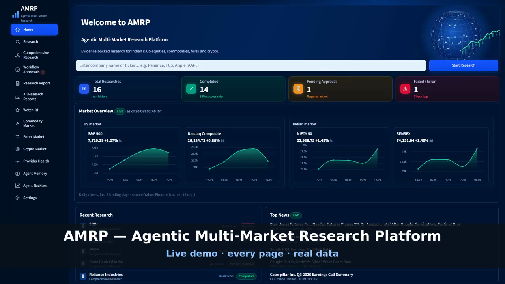](docs/media/AMRP-Demo-720p.mp4)

**[▶️ Watch the full demo (15:46, every page with live data)](docs/media/AMRP-Demo-720p.mp4)** — click *View raw* / *Download* on GitHub to play it.

The walkthrough covers Home, Research, Comprehensive Research (Auto and Manual), Workflow Approvals, the Research Report and PDF export, All Reports, Watchlist, the Commodity / Forex / Crypto markets, Provider Health, Agent Memory, Agent Backtest and Settings.

## 💡 Why AMRP?

Most "stock chat" tools optimise for fluent answers. AMRP optimises for answers you can **check**:

- 🔎 **Evidence first** — every claim carries a tag (`[M1]` market, `[F1]` financial, `[N1]` news, `[R1]` regulatory) that resolves to a timestamped source.
- 🐂🐻 **Deliberation, not a single prompt** — Bull vs Bear debate, a citation verifier, a Judge and a three-view risk panel.
- 🙋 **Human in the loop** — run fully automatic, or approve every agent step yourself.
- 💸 **Free by default** — free OpenRouter models, free Yahoo Finance data; paid models only if you opt in.
- 🔐 **Local and safe** — everything binds to `127.0.0.1`; API keys are write-only and never shown or logged.

## ✨ Features, page by page

| Page | What it does | Why use it |
|---|---|---|
| 🏠 **Home** | Type a company or ticker (`RELIANCE`, `Wipro Limited`, `AAPL` — no `.NS` needed) and get a full report. Shows run counts, a live US/India market overview, recent research and top news. | One click → complete research. |
| 🔬 **Research** | Pick only the objectives you need (Overview, Financial, News, Industry, Regulatory). | Fast, focused answer to one question. |
| 🤖 **Comprehensive Research** | Watch five agents (Market, Financial, News, Industry, Regulatory) work live. **Auto** 🟢 runs straight through; **Manual** 🔴 pauses for Approve / Skip at every step. | Full control, and a clear view of how the agents work. |
| ✅ **Workflow Approvals** | Queue of runs waiting for a human; Approve or Reject, with workflow steps and recent activity. | Human-in-the-loop governance. |
| 📄 **Research Report** | Tabbed report: key figures, news, regulatory items, **Bull vs Bear debate**, risk panel, final rating (Strong Buy → Strong Sell) with confidence, and **PDF export**. | The deliverable you share. |
| 🗂️ **All Research Reports** | Search and filter every past report and reopen it, even after a restart. | Find an old report in seconds. |
| ⭐ **Watchlist** | Companies **and** commodity, forex and crypto symbols (`GC=F`, `EURUSD=X`, `BTC-USD`) with price, change and a coloured trend column. | Track everything in one table. |
| 🥇💱₿ **Commodity / Forex / Crypto** | Live USD prices, session charts (Asia / London / New York, IST), related news, **Analyze with AI** and a live **Bullish 🐂 / Bearish 🐻 / Neutral ✖️** badge recomputed on every page open. | Quick read on non-equity markets. |
| 🩺 **Provider Health** | Every data source and API shown as unused / ok / degraded / failing. | Know instantly if a source is down. |
| 🧠 **Agent Memory** | Each rating is settled 21 days later against the real price; hit rate and lessons feed the next run on that ticker. | Agents that learn from their own mistakes. |
| 📈 **Agent Backtest** | Replays point-in-time ratings across horizons and scores them against buy-and-hold — honest results, good or bad. | See whether the ratings actually work. |
| ⚙️ **Settings** | Guided provider setup (OpenRouter, OpenAI, Anthropic, Gemini, Groq, custom), Test connection, debate rounds and a built-in setup guide. Keys are masked and write-only. | Configure once, safely. |

## 📸 Screenshots

| Home | Research result |
|---|---|
|  | 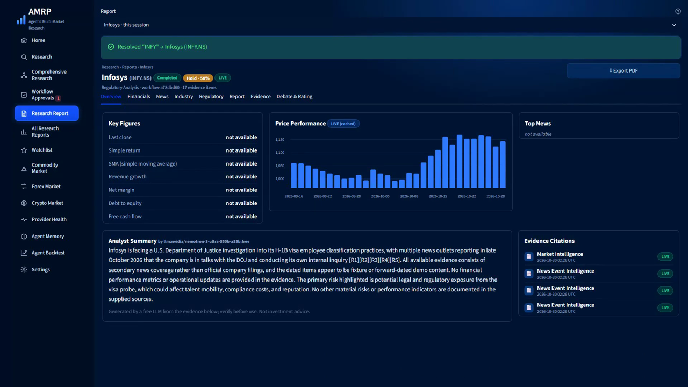 |
| **Comprehensive Research (5 agents)** | **Workflow Approvals** |
|  |  |
| **Research Report** | **PDF export** |
| 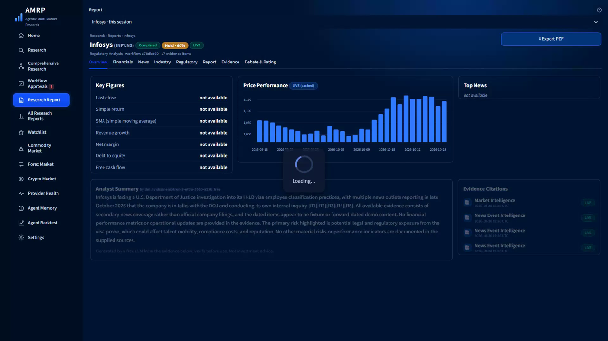 | 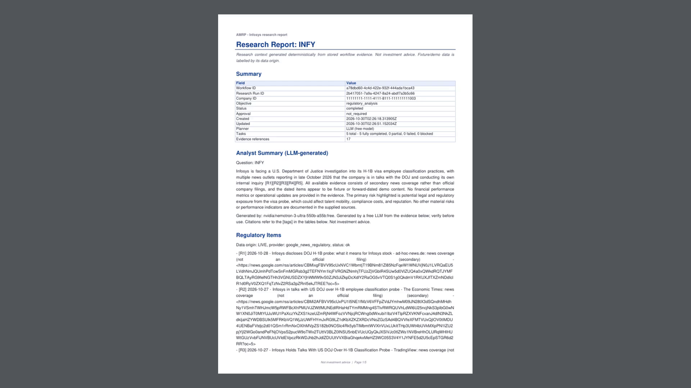 |
| **All Research Reports** | **Watchlist with trend column** |
| 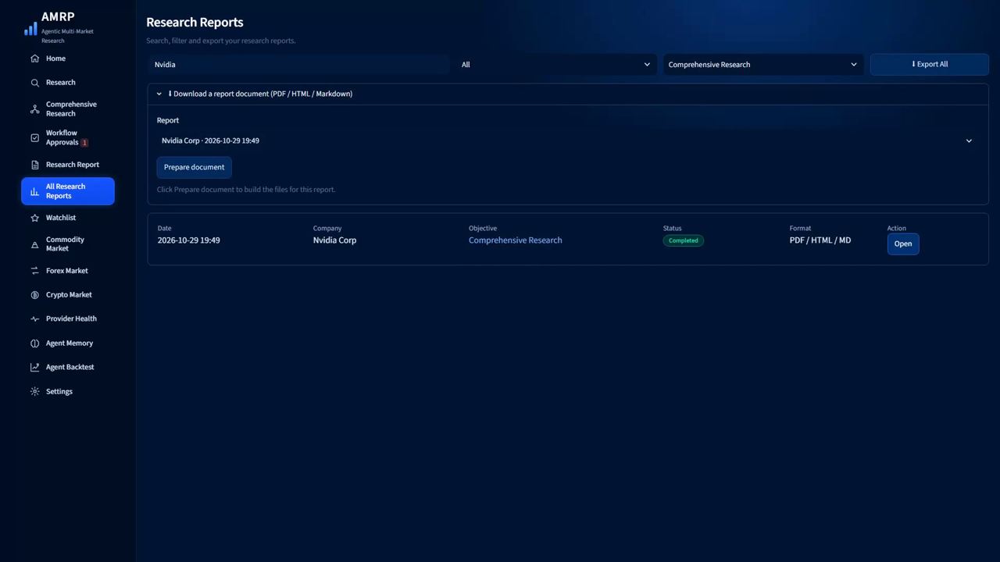 | 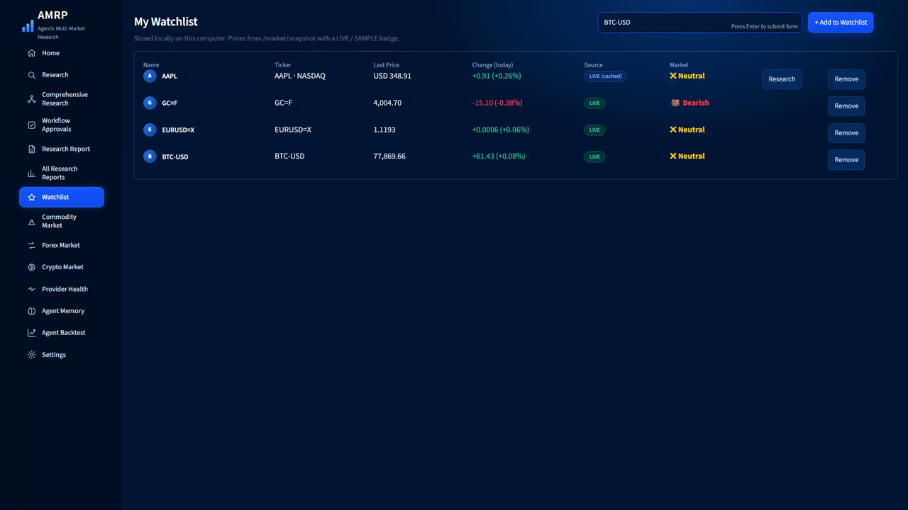 |
| **Commodity market + trend badge** | **Forex market** |
| 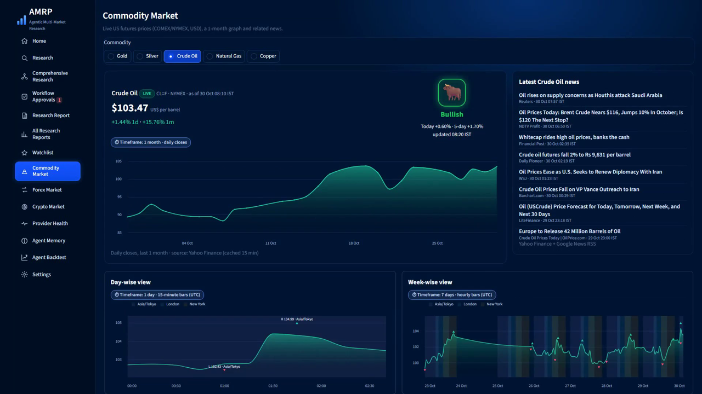 | 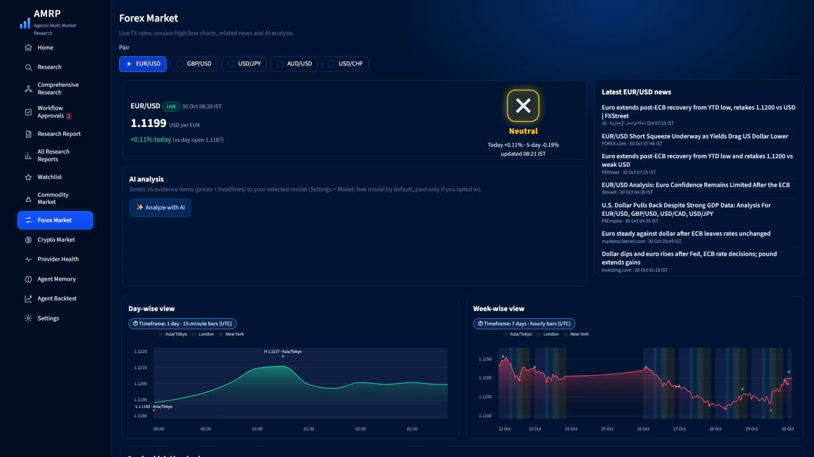 |
| **Crypto market** | **Provider Health** |
| 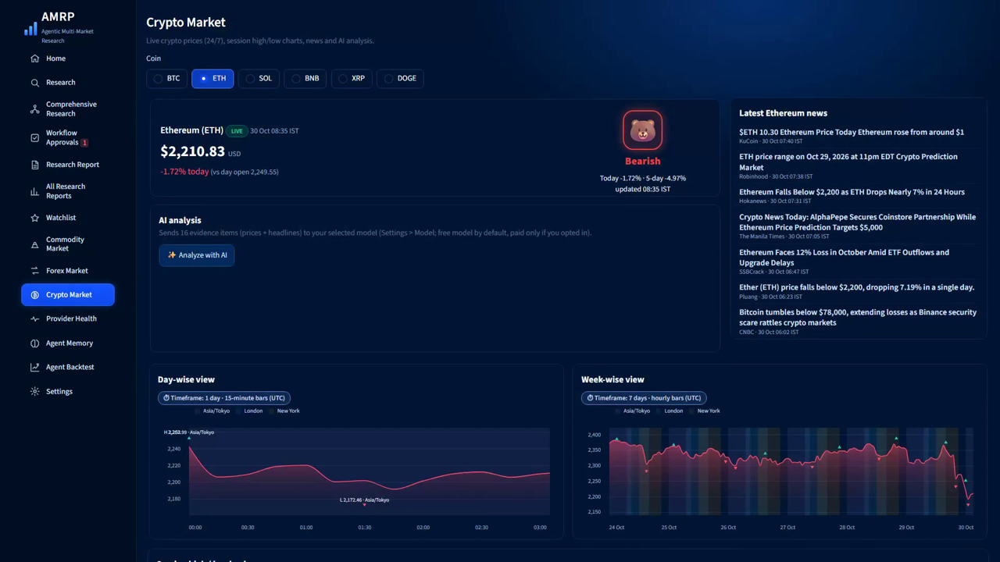 | 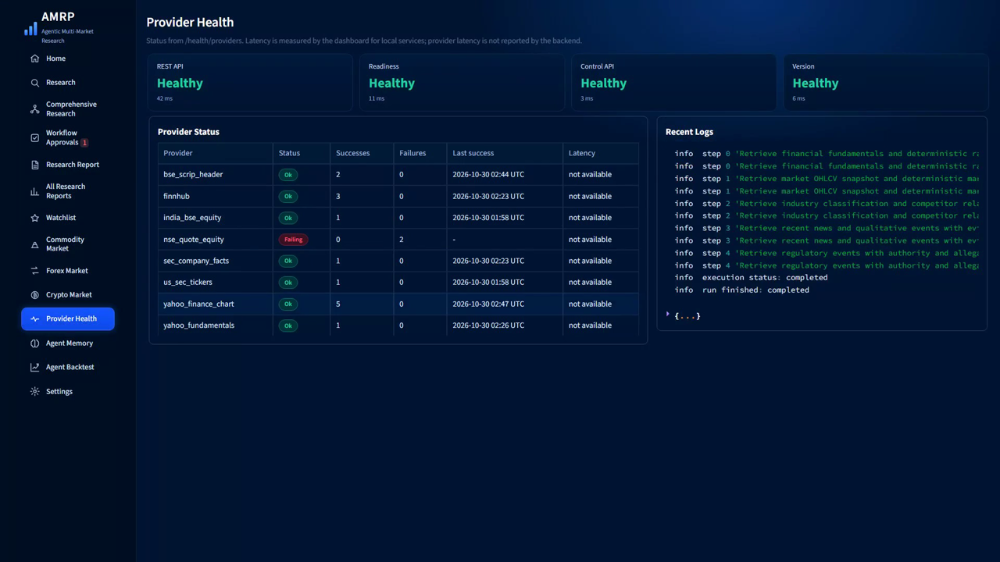 |
| **Agent Memory** | **Agent Backtest** |
| 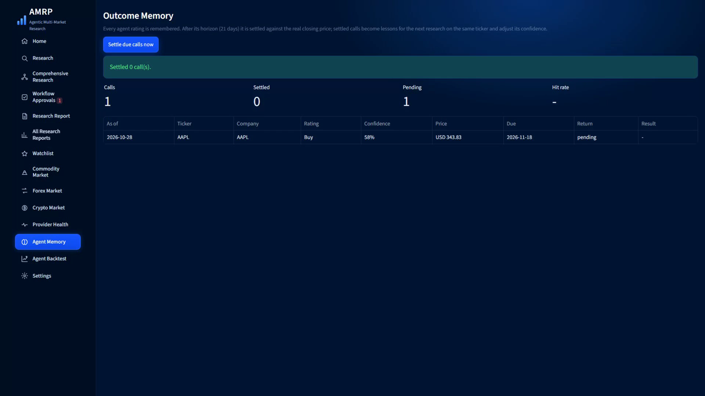 | 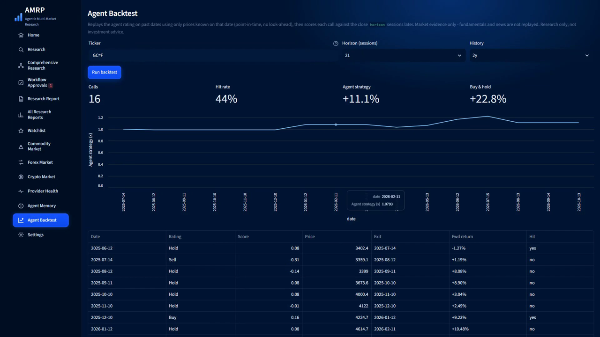 |
| **Settings + setup guide** | |
| 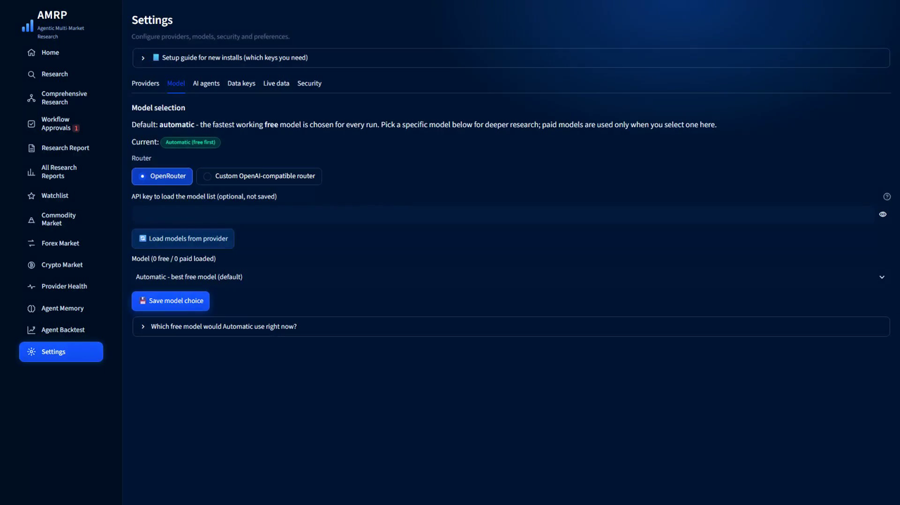 | |

## 🏗️ Architecture

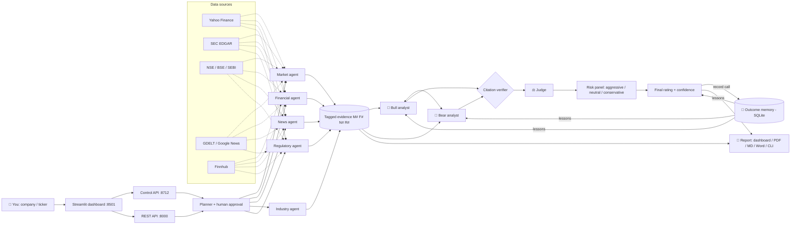

Calculations, validation, retrieval, caching and formatting are deterministic code. LLMs interpret the evidence; they never become the evidence. More detail: [ARCHITECTURE.md](ARCHITECTURE.md), [EVIDENCE_MODEL.md](EVIDENCE_MODEL.md), [DATA_SOURCES.md](DATA_SOURCES.md), [MODEL_POLICY.md](MODEL_POLICY.md).

## 🚀 Quick start for anyone

### 1. Prerequisites

| Need | Version / note |
|---|---|
| 🐍 Python | **3.12 or 3.13** ([python.org](https://www.python.org/downloads/)) — on Windows tick *Add python.exe to PATH* |
| 🌿 Git | any recent version ([git-scm.com](https://git-scm.com/downloads)) |
| 🔑 API key | **OpenRouter** (free) for the AI agents — optional; without it AMRP runs in deterministic mode |
| 💻 OS | Windows 10/11, macOS or Linux; ~1 GB free disk |

### 2. Get the code

```bash
git clone https://github.com/LeelaissakAttota/agentic-multi-market-research-platform.git
cd agentic-multi-market-research-platform
```

### 3. Create a virtual environment and install

**Windows (PowerShell)**

```powershell
python -m venv .venv
.\.venv\Scripts\Activate.ps1          # if blocked: Set-ExecutionPolicy -Scope CurrentUser RemoteSigned
python -m pip install -r requirements-lock.txt
python -m pip install -e . --no-deps
python -m pip install -r dashboard/requirements.txt
Copy-Item .env.example .env
```

**macOS / Linux (bash / zsh)**

```bash
python3 -m venv .venv
source .venv/bin/activate
python -m pip install -r requirements-lock.txt
python -m pip install -e . --no-deps
python -m pip install -r dashboard/requirements.txt
cp .env.example .env
```

### 4. Add your API keys (all free tiers)

Open `.env` in any editor **or** use the dashboard's ⚙️ **Settings** page (it has the same setup guide and a *Test connection* button). Never commit `.env`.

| Variable | Needed? | What it unlocks | Get it at |
|---|---|---|---|
| `OPENROUTER_API_KEY` | Recommended | AI agents, Bull/Bear debate, Judge, *Analyze with AI* (free models) | [openrouter.ai/keys](https://openrouter.ai/keys) |
| `OPENROUTER_LIVE_ENABLED` | with the key | set to `true` to turn live AI on | — |
| `FINNHUB_API_KEY` | Optional | US company news, analyst consensus, next earnings date | [finnhub.io/register](https://finnhub.io/register) |
| `ALPHA_VANTAGE_API_KEY` | Optional | Extra market-data provider (limited free requests/day) | [alphavantage.co](https://www.alphavantage.co/support/#api-key) |
| `SEC_USER_AGENT` | Optional (US filings) | SEC EDGAR financials; format `Your Name you@email.com` | no signup needed |

Prices from Yahoo Finance need **no key**. OpenAI, Anthropic, Gemini, Groq or any OpenAI-compatible endpoint can be added from Settings instead of OpenRouter.

### 5. Start it

| OS | Command |
|---|---|
| 🪟 Windows | `.\scripts\start-dashboard.ps1` |
| 🍎 macOS / 🐧 Linux | `./scripts/start-dashboard.sh` |

Then open **http://127.0.0.1:8501**. Press `Ctrl+C` to stop everything.

| Service | Port | URL |
|---|---|---|
| Dashboard (Streamlit) | 8501 | http://127.0.0.1:8501 |
| REST API (FastAPI, docs) | 8000 | http://127.0.0.1:8000/docs |
| Control API (dashboard only, random per-session token) | 8712 | — |

Try `RELIANCE`, `AAPL`, `Wipro Limited` on Home, or `GC=F` (Gold), `EURUSD=X`, `BTC-USD` in the markets and Watchlist.

### 🛠️ Troubleshooting

| Problem | Fix |
|---|---|
| `running scripts is disabled` (Windows) | `Set-ExecutionPolicy -Scope CurrentUser RemoteSigned`, or run `powershell -ExecutionPolicy Bypass -File .\scripts\start-dashboard.ps1` |
| `Port 8501 is not available` | Another app (or an old AMRP) uses the port. Close it, or on Windows: `.\scripts\start-dashboard.ps1 -DashboardPort 8502`; on macOS/Linux: `DASHBOARD_PORT=8502 ./scripts/start-dashboard.sh` (same for `ApiPort`/`API_PORT`, `ControlPort`/`CONTROL_PORT`) |
| `Permission denied: ./scripts/start-dashboard.sh` | `chmod +x scripts/start-dashboard.sh` |
| `ModuleNotFoundError: amrp` | Activate the venv and re-run `python -m pip install -e . --no-deps` |
| Dashboard shows *SAMPLE DATA* / AI is off | Add `OPENROUTER_API_KEY` and set `OPENROUTER_LIVE_ENABLED=true` (or use Settings), then restart |
| A run is slow | Free `auto` models vary; choose a fixed fast model in Settings. A full run usually takes ~1.5 minutes |
| Something failed | Check `logs/api.log` and `logs/control.log`, and the 🩺 Provider Health page |

<details>
<summary>🐳 Docker and CLI</summary>

```bash
docker compose up --build     # REST API on http://127.0.0.1:8000
amrp research --ticker AAPL --market us --format pdf --approve          # CLI full run
amrp research --ticker TCS.NS --market in --as-of 2026-06-30 --resume  # continue a stopped run
```
</details>

## 🧪 Tests

```bash
python -m pytest                                   # 1,683 passing
python -m ruff check . ; python -m ruff format --check .
python -m mypy src
```

Unit, contract, integration and evaluation tests run in CI on Python 3.12 and 3.13. See [TESTING_STRATEGY.md](TESTING_STRATEGY.md).

## 🙏 Inspired by TradingAgents

The debate / risk-panel / judge layer was inspired by [TradingAgents](https://github.com/TauricResearch/TradingAgents) (Apache-2.0, Xiao et al., [arXiv 2412.20138](https://arxiv.org/abs/2412.20138)). It was written independently for AMRP; no code was copied.

| | TradingAgents | AMRP |
|---|---|---|
| Goal | Trading decisions | Evidence-first research reports |
| Debate | Bull vs Bear, then a manager | Bull vs Bear, then a Judge; every point **citation-verified** |
| Risk | Risky / safe / neutral debaters | Aggressive / neutral / conservative, anchored on deterministic risk flags |
| Memory | Reflection memory | Outcome memory settled against real later prices |
| Execution | Simulated trading | **No orders ever**; human approval gates |

## 🔐 Security

API keys are write-only in Settings and never logged or displayed; the control API uses a random per-session token; services bind to `127.0.0.1`; network access is host-allowlisted. See [SECURITY_GUIDELINES.md](SECURITY_GUIDELINES.md).

## 📜 License

[MIT](LICENSE) © 2026 Attota Leelaissak

## ⚠️ Disclaimer

AMRP is a research and educational project. **It is not financial advice**, it never places trades, and its ratings can be wrong (the Agent Backtest page shows this openly). Always do your own research and consult a licensed advisor before investing.
